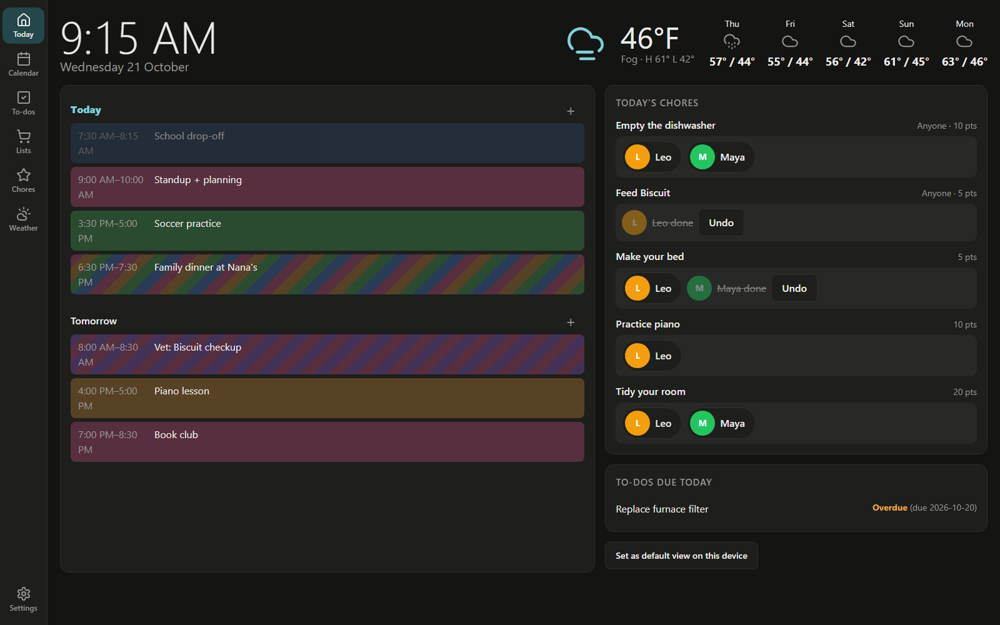
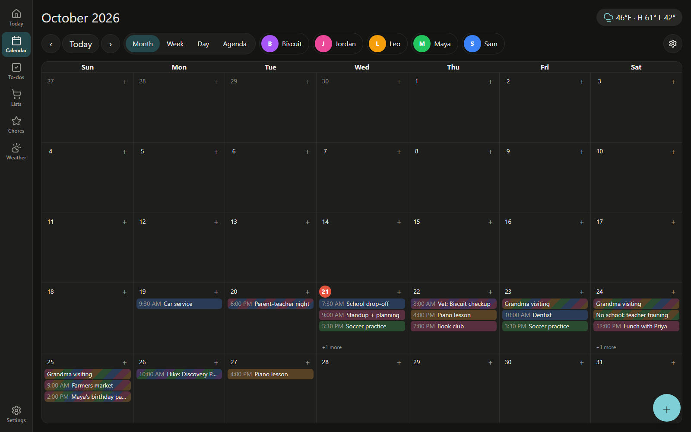
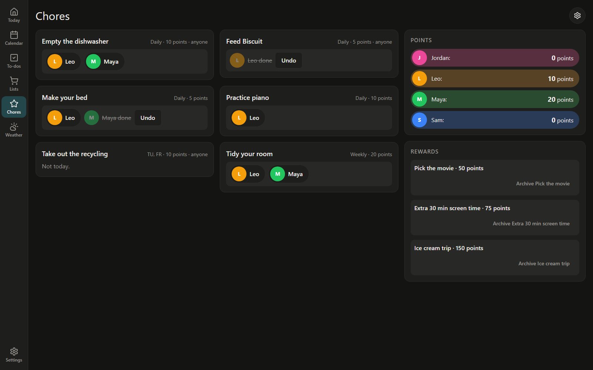
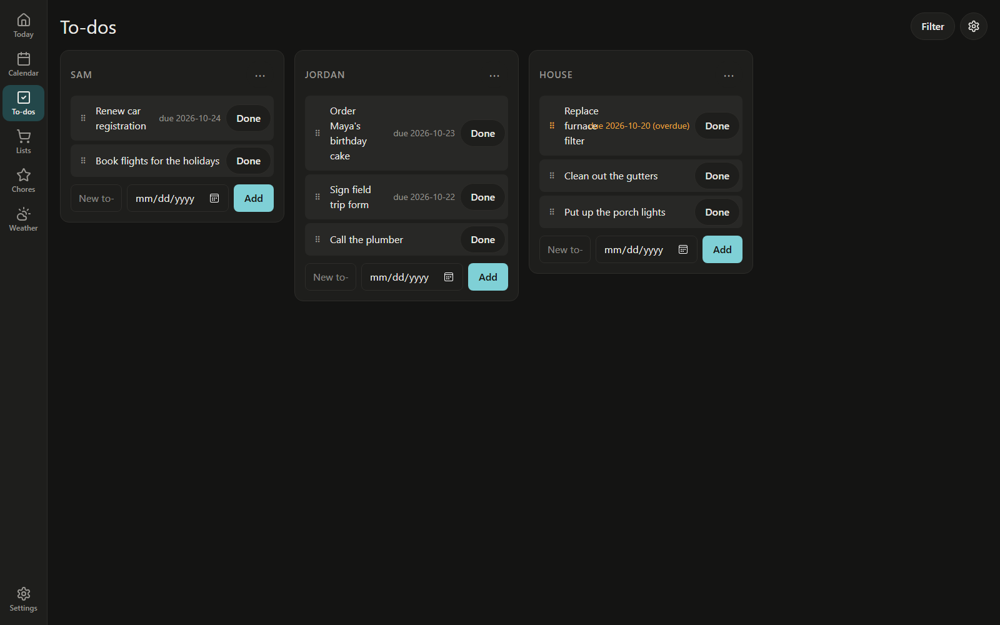
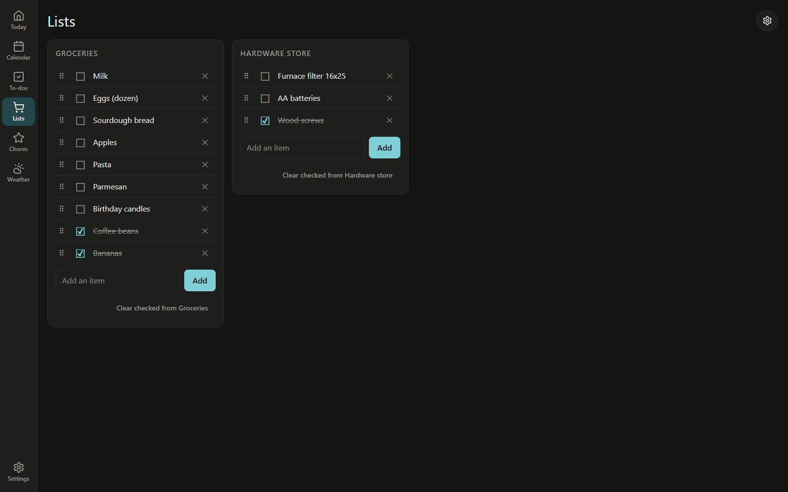
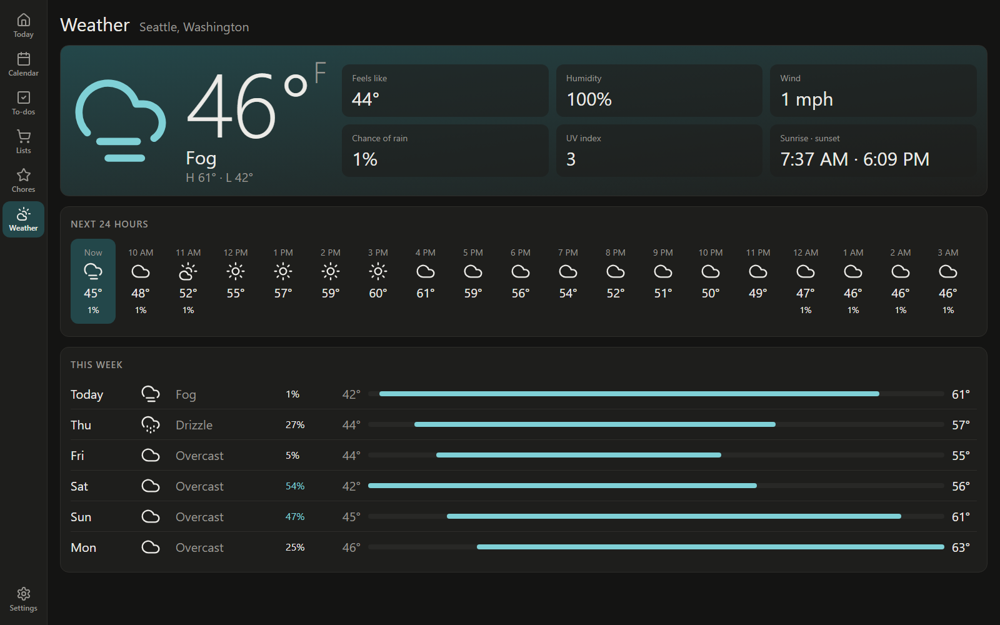
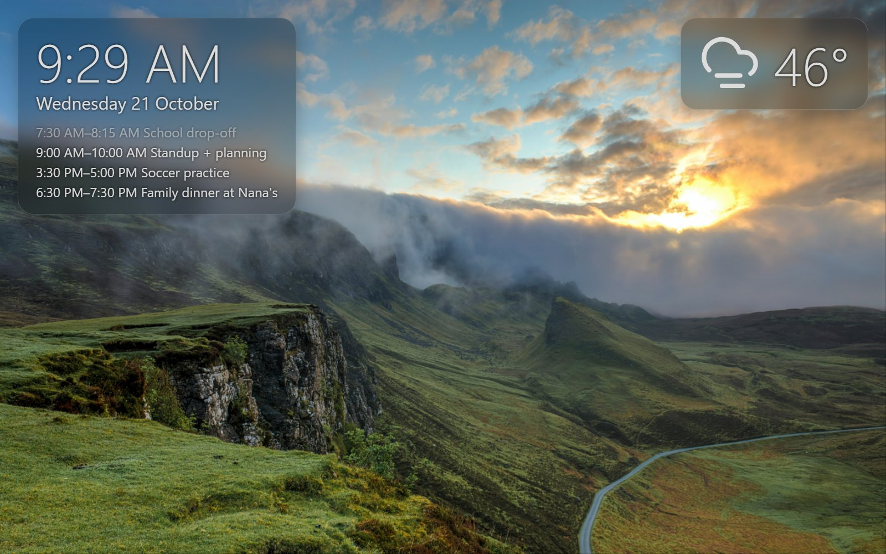
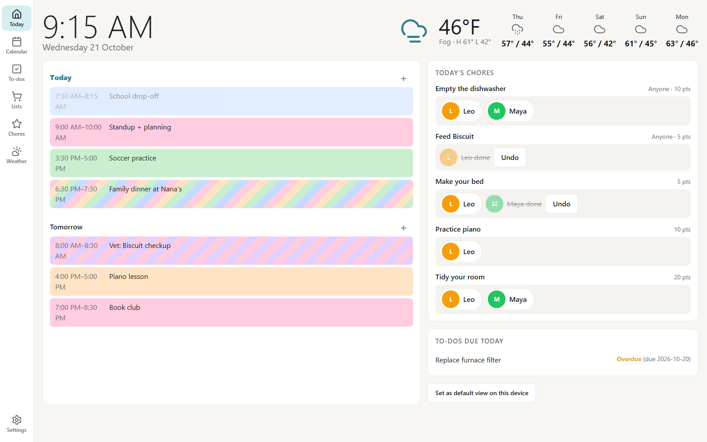

# GoCasa

**A self-hosted family wall calendar for your homelab.** The kitchen-tablet dashboard you'd otherwise buy as a subscription gadget, running on hardware you already own: calendars, chores, to-dos, shopping lists, weather and a photo screensaver, on any old tablet or screen with a browser.

One static Go binary, one SQLite file, no cloud account, no subscription, no telemetry. Runs happily on a Raspberry Pi.



## Why homelabbers like it

- **Tiny footprint.** A single static binary (pure Go, no CGO) and one SQLite file. Multi-arch Docker image for `amd64` and `arm64`.
- **Plays well with your stack.** Shopping lists sync with [Mealie](https://mealie.io), the screensaver shows albums and people from [Immich](https://immich.app), calendars come from Google or any iCal feed, and the whole family calendar is published back out as an `.ics` feed.
- **Your data stays home.** Everything lives in `/data`. Integration tokens are encrypted at rest. Nightly backups and pre-migration snapshots happen on their own.
- **No logins for the family.** Anyone at the screen can view and tick things off. Admins have a PIN for settings, and you choose which actions (changing the calendar, completing chores or to-dos) need it.
- **Built for a wall display.** Screen Wake Lock, a photo screensaver, night mode (black or a dim clock), and optional camera motion-wake that never sends a frame off the device.
- **Behind your reverse proxy.** Plain HTTP, `BASE_URL` for its public name, a `/healthz` endpoint, and a live-update stream that copes with proxy buffering and idle timeouts.

## Screenshots

| | |
|---|---|
|  **Calendar**: month, week, day and agenda views, colour-coded by person, with recurring events. |  **Chores**: daily, weekly or per-weekday chores, points, and rewards kids can request. |
|  **To-dos**: columns per person or room, due dates, repeating tasks. |  **Lists**: shopping lists, local or synced two-way with Mealie. |
|  **Weather**: current conditions, the next 24 hours and the week, from Open-Meteo (no API key). |  **Screensaver**: Immich photos or a local folder, with the clock, today's agenda and the weather. |

Light mode follows the device, or set it per screen:



## Features

- **Calendars:** a local calendar, two-way Google Calendar sync (several Google accounts, your own OAuth client), read-only iCal/webcal feeds, and an ICS export at `/calendar.ics` for phones and other apps.
- **Members:** each person (pets too) gets a colour and an optional picture; events, chores and to-dos are tagged by who they're for.
- **Chores and rewards:** "each" chores everyone does, "anyone" chores the first taker claims, points balances, rewards that need an Admin's approval.
- **To-dos:** columns, drag to reorder, due dates, repeat on a schedule or from completion.
- **Shopping lists:** local lists, plus your Mealie (v2+) shopping lists kept in sync.
- **Weather:** from [Open-Meteo](https://open-meteo.com), metric or imperial, on the Today page, its own page and the screensaver.
- **Screensaver:** after a configurable idle time, photos from chosen Immich albums or people, or from a folder you mount.
- **Per-device settings:** default view, light/dark theme, Wall display mode, motion-wake.

## Quick start

You need Docker and two random secrets.

```sh
git clone https://github.com/DeRusto/goCasa.git && cd goCasa
cp .env.example .env
# fill in APP_ENCRYPTION_KEY and SESSION_SECRET: openssl rand -base64 32
docker compose up -d
```

Open `http://<host>:8080`, add your family under Settings → Members, and point a tablet at it. `GET /healthz` returns `200 ok` when the app is up and the database answers.

Prefer a published image or a bare binary? Each [release](https://github.com/DeRusto/goCasa/releases) ships `ghcr.io/derusto/gocasa:<version>` (amd64 and arm64) and static binaries for Linux, macOS and Windows. To use the image, replace `build: .` in `compose.yaml` with `image: ghcr.io/derusto/gocasa:<version>`. To run the binary, put a `.env` next to it (or set the variables from [Configuration](#configuration)) and start it from that directory; it serves on `:8080`.

### Wall display tips

- Any browser works. For a kiosk, open GoCasa full screen and turn on **Wall display** in Settings on that device (an Admin's PIN is needed): it keeps the screen awake and shows the screensaver when idle.
- Wake Lock and camera motion-wake need HTTPS; see [HTTPS](#https).
- Night mode blanks the screen or shows a dim clock between the hours you pick.

## Data and photos

Data lives in the `gocasa-data` volume at `/data` (`app.db`, `backups/`, `photo-cache/`, `photos/`). To use a bind mount instead, make the host directory writable by UID 65532, which the container runs as: `sudo chown 65532:65532 ./data`.

The screensaver's Fallback folder is `/data/photos`: when Immich has no photos to show, it shows the JPEG, PNG and WebP images there, subfolders included, rescanned hourly and on "Refresh now". Bind-mount a folder of your own images there, read-only is fine: `- ./photos:/data/photos:ro`.

## Configuration

Config comes from environment variables. Without Docker, the binary also reads a `.env` file (same format as `.env.example`) from the directory you start it in; variables already set in the environment win. Set `DATA_DIR` to a real path there, e.g. `DATA_DIR=./data`.

| Variable | Default | Meaning |
|---|---|---|
| `ADDR` | `:8080` | Listen address. GoCasa serves plain HTTP only |
| `BASE_URL` | (required) | How clients reach GoCasa, e.g. `https://casa.example.com`. Drives Secure cookies, the Google redirect and absolute links |
| `DATA_DIR` | `/data` | Holds `app.db` and its siblings |
| `TZ` | `UTC` | The Household's default IANA zone, e.g. `America/Los_Angeles`. Events keep their own zones. Zone data is built into the binary |
| `APP_ENCRYPTION_KEY` | (required) | 32 random bytes, base64. Encrypts OAuth tokens and API keys at rest. **Back it up; losing it means reconnecting every integration** |
| `SESSION_SECRET` | (required) | At least 32 characters |
| `GOOGLE_CLIENT_ID`, `GOOGLE_CLIENT_SECRET` | (unset) | Your own Google OAuth client, to connect Google calendars. Set both or neither; see [Google calendars](#google-calendars) |
| `GOOGLE_REDIRECT_URI` | `${BASE_URL}/auth/google/callback` | Override for the localhost / `ssh -L` route |

The binary refuses to start if a required value is missing or malformed, and says which one.

## Google calendars

GoCasa never ships a shared Google client: each Household makes its own, free, in a few minutes. You need a Google account; it needn't be one whose calendars you connect.

1. In the [Google Cloud console](https://console.cloud.google.com/), create a project, e.g. "GoCasa".
2. **APIs & Services → Library**: enable the **Google Calendar API**.
3. **APIs & Services → OAuth consent screen** (Google Auth Platform): user type **External** (a Google Workspace household can pick **Internal** instead and skip step 6). Fill in the app name and your email. Under **Data access** add the scopes `openid`, `https://www.googleapis.com/auth/userinfo.email`, `https://www.googleapis.com/auth/calendar.events` and `https://www.googleapis.com/auth/calendar.calendarlist.readonly`.
4. **Credentials → Create credentials → OAuth client ID**: type **Web application**, authorised redirect URI exactly what Settings shows under *Google accounts*: `${BASE_URL}/auth/google/callback`, e.g. `https://casa.example.com/auth/google/callback`.
5. Put the client ID and secret in `.env` as `GOOGLE_CLIENT_ID` and `GOOGLE_CLIENT_SECRET` and restart GoCasa.
6. **Audience → Publish app**: move it from **Testing** to **In production**. Don't skip this: in Testing, Google expires the connection every 7 days. You don't need Google's verification: a personal app with under 100 users is exempt.
7. In Settings → *Google accounts*, **Connect a Google account**. Google warns **"Google hasn't verified this app"**: that's your own app, so click **Advanced → Go to GoCasa (unsafe)** and allow access. Then tick **Show** on the calendars you want and pick their default Members.

Connect more logins the same way; each is its own Google account in Settings. **Reconnect** signs the same login in again and keeps its calendars and Member defaults; signing in as a different login is refused. **Disconnect** tells Google to drop GoCasa's access and deletes that account's calendars and events here, with their Member defaults and any Member changes made to its events.

**Without HTTPS:** Google only accepts an `https` redirect on a real domain, or plain `http://localhost`. If GoCasa has no HTTPS name yet, connect once from the host itself or through an SSH tunnel from your computer: `ssh -L 8080:localhost:8080 you@gocasa-host`. Set `GOOGLE_REDIRECT_URI=http://localhost:8080/auth/google/callback`, use that as the client's redirect URI, restart, and open `http://localhost:8080/settings` to connect. The connection keeps working afterwards from any address; only connecting and reconnecting need the redirect. If `BASE_URL` is `https`, use Chrome or Firefox for this: Safari won't keep GoCasa's secure cookies on `http://localhost`.

## Backups and restore

GoCasa backs up `app.db` with `VACUUM INTO` to `/data/backups/app-YYYYMMDD.db` every day at 03:00 in `TZ`, and keeps the newest 14. If the newest backup is over 24 hours old when GoCasa starts (say it was off at 03:00), it takes one straight away. Neither the time nor the count is configurable. Copy `backups/` off the host if you want backups that survive the disk.

To restore:

1. Stop the container: `docker compose stop`.
2. In the data volume, move `app.db` aside and delete `app.db-wal` and `app.db-shm` if present: they belong to the old file.
3. Copy the backup you want to `app.db`, e.g. `cp backups/app-20261018.db app.db`.
4. Start it: `docker compose start`.

## Upgrades and migrations

Replace the image and start it. Migrations are embedded in the binary and run at startup in order, one transaction each; the schema version is tracked in SQLite's `PRAGMA user_version`. Before running any pending migration GoCasa writes `backups/app-YYYYMMDD-pre-vN.db`, where `N` is the schema version it is upgrading from; if that backup fails, it refuses to start rather than migrate unprotected. Pre-migration backups are never pruned; delete old ones yourself. To roll back, run the previous image and restore that file. GoCasa refuses to start on a database written by a newer version: run the newer image again, or restore a backup.

## HTTPS

GoCasa speaks plain HTTP and expects your reverse proxy to terminate TLS. It ignores `X-Forwarded-*` headers and takes its own address from `BASE_URL`, so set `BASE_URL` to the `https://` name people actually type.

**Why bother:** over plain HTTP everything works except Screen Wake Lock and camera motion-wake on the Wall display (browsers allow them only in a secure context) and Connect Google (Google requires an `https` redirect on a real domain). Settings tells you HTTPS turns them on.

**Recipe:**

1. Pick a name on a domain you own, e.g. `casa.example.com`.
2. Point it at the GoCasa host's LAN IP in your local DNS (router, Pi-hole, AdGuard). It needn't resolve publicly: the Google redirect happens in the browser.
3. Give a reverse proxy a real certificate for that name, e.g. Let's Encrypt with a DNS-01 challenge (no ports open to the internet).
4. Set `BASE_URL=https://casa.example.com` and restart GoCasa.

### Example: Nginx Proxy Manager

1. **SSL Certificates → Add → Let's Encrypt**: domain `casa.example.com`, turn on **Use a DNS Challenge**, pick your DNS provider and paste its API token.
2. **Hosts → Proxy Hosts → Add**: domain `casa.example.com`, scheme `http`, forward host the GoCasa host's IP, port `8080`. On the **SSL** tab pick the certificate and turn on **Force SSL**.

No custom Nginx config is needed: GoCasa's live-update stream handles proxy buffering and idle timeouts itself.

### Remote access

Reaching GoCasa from outside your home network is out of scope. That is your homelab's job (a tunnel, a VPN, an authenticating proxy); GoCasa documents none of them.

## Development

```sh
go test ./...
go tool templ generate   # after editing any .templ file; *_templ.go is committed
go generate ./internal/web   # templ, then Tailwind: after changing classes; static/app.css is committed
go run ./cmd/gocasa      # reads ./.env; set DATA_DIR=./data there
```

Styling is Tailwind v4 (`internal/web/input.css`), built by its standalone CLI so there's no Node. Put the [v4.3.3 binary](https://github.com/tailwindlabs/tailwindcss/releases/tag/v4.3.3) for your platform on your PATH as `tailwindcss`. Only changing classes needs it: builds and Docker use the committed `app.css`.

Tests build the real app through `internal/apptest`: a temp SQLite file, a fake clock, fake upstream URLs and `RunDue` to run scheduled work on demand.

The README screenshots come from a fictional household: start the `gocasa-demo` entry in `.claude/launch.json` (port 8090, data in `./tmp/demo`), load `sqlite3 tmp/demo/app.db < docs/screenshots/seed.sql`, and capture at 1600×1000.
